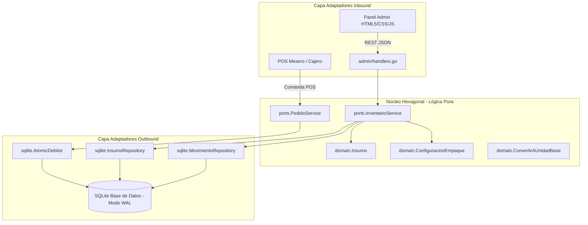
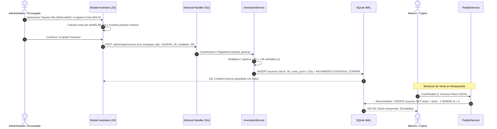

# Plan de Arquitectura e Interfaz UI — 005: Empaques y Presentaciones de Cervezas y Bebidas

**Versión:** 1.0  
**Fecha:** 2026-10-20  
**Estado:** BORRADOR — Pendiente de Aprobación  
**Referencia:** `specs/005-empaques-cervezas-personalizados/spec.md`  
**Stack:** Go 1.22+ · SQLite WAL · HTML5 / Vanilla CSS / Vanilla JS (ES6+) · Arquitectura Hexagonal Estricta

---

## 1. Visión General de la Arquitectura

La implementación respeta de forma estricta los límites hexagonales del proyecto, manteniendo `internal/core/` completamente aislado de librerías HTTP, bases de datos o frameworks externos.

### 1.1 Diagrama de Arquitectura Hexagonal



### 1.2 Flujo Operativo: De la Gavera a la Botella



---

## 2. Backend / Base de Datos & Migraciones

### 2.1 Migración SQL: `000006_empaques_cervezas_bebidas.up.sql`

Se amplía la tabla `insumos` con columnas dedicadas para la parametrización de empaques, asegurando compatibilidad hacia atrás con los insumos existentes (que mantendrán `empaque_tipo = 'UNITARIO'` y `unidades_por_empaque = 1`).

```sql
-- ==============================================================================
-- Migración: 000006_empaques_cervezas_bebidas.up.sql
-- Propósito: Agregar metadatos de empaques predefinidos y personalizados
--            para cervezas y bebidas, garantizando conversiones exactas a unidad 'u'.
-- ==============================================================================

ALTER TABLE insumos ADD COLUMN empaque_tipo TEXT NOT NULL DEFAULT 'UNITARIO' 
    CHECK (empaque_tipo IN ('UNITARIO', 'GAVERA_36', 'CAJA_24_BOT', 'CAJA_24_LATA', 'SIX_PACK_6', 'CAJA_12_ART', 'PERSONALIZADO'));

ALTER TABLE insumos ADD COLUMN empaque_nombre TEXT NOT NULL DEFAULT '';

ALTER TABLE insumos ADD COLUMN unidades_por_empaque INTEGER NOT NULL DEFAULT 1 
    CHECK (unidades_por_empaque >= 1);

ALTER TABLE insumos ADD COLUMN contenido_ml_por_unidad REAL NOT NULL DEFAULT 0.0 
    CHECK (contenido_ml_por_unidad >= 0.0);

ALTER TABLE insumos ADD COLUMN es_retornable INTEGER NOT NULL DEFAULT 0 
    CHECK (es_retornable IN (0, 1));

-- Índices de optimización para filtros rápidos en inventario
CREATE INDEX IF NOT EXISTS idx_insumos_empaque_tipo ON insumos(empaque_tipo);
CREATE INDEX IF NOT EXISTS idx_insumos_retornable ON insumos(es_retornable);
```

### 2.2 Migración Rollback: `000006_empaques_cervezas_bebidas.down.sql`

```sql
-- ==============================================================================
-- Migración: 000006_empaques_cervezas_bebidas.down.sql
-- ==============================================================================

DROP INDEX IF EXISTS idx_insumos_retornable;
DROP INDEX IF EXISTS idx_insumos_empaque_tipo;

ALTER TABLE insumos DROP COLUMN es_retornable;
ALTER TABLE insumos DROP COLUMN contenido_ml_por_unidad;
ALTER TABLE insumos DROP COLUMN unidades_por_empaque;
ALTER TABLE insumos DROP COLUMN empaque_nombre;
ALTER TABLE insumos DROP COLUMN empaque_tipo;
```

---

## 3. Capa de Dominio (Hexagonal Core)

### 3.1 Entidad `Insumo` y Tipos de Empaque (`internal/core/domain/insumo.go`)

Se amplía la entidad `Insumo` sin romper su condición de modelo puro:

```go
// TipoEmpaque define las categorías estándar y personalizadas de empaque de bebidas.
type TipoEmpaque string

const (
    EmpaqueUnitario      TipoEmpaque = "UNITARIO"
    EmpaqueGavera36      TipoEmpaque = "GAVERA_36"
    EmpaqueCaja24Bot     TipoEmpaque = "CAJA_24_BOT"
    EmpaqueCaja24Lata    TipoEmpaque = "CAJA_24_LATA"
    EmpaqueSixPack6      TipoEmpaque = "SIX_PACK_6"
    EmpaqueCaja12Art     TipoEmpaque = "CAJA_12_ART"
    EmpaquePersonalizado TipoEmpaque = "PERSONALIZADO"
)

// Insumo representa una materia prima o producto físico del restaurante.
type Insumo struct {
    ID                   int         `json:"id"`
    Nombre               string      `json:"nombre"`
    UnidadBase           string      `json:"unidad_base"`      // Para bebidas: siempre "u"
    CostoPromedio        float64     `json:"costo_promedio"`   // Costo monetario por botella/lata
    StockMinimo          float64     `json:"stock_minimo"`     // Expresado en botellas/latas individuales
    Stock                float64     `json:"stock"`            // Cantidad física actual en botellas
    PrecioVentaUSD       float64     `json:"precio_venta_usd"` // Precio de venta por botella/lata
    EmpaqueTipo          TipoEmpaque `json:"empaque_tipo"`     // Categoría de empaque
    EmpaqueNombre        string      `json:"empaque_nombre"`   // Nombre comercial o personalizado
    UnidadesPorEmpaque   int         `json:"unidades_por_empaque"` // Ej: 36, 24, 6, 12 o N
    ContenidoMlPorUnidad float64     `json:"contenido_ml_por_unidad"` // Ej: 222, 250, 330, 355 ml
    EsRetornable         bool        `json:"es_retornable"`    // True para envases retornables (gaveras)
}
```

### 3.2 Lógica Pura de Conversión de Empaques

Se incorporan métodos de conveniencia en el dominio:

```go
// UnidadesPorDefectoEmpaque devuelve el factor canónico según el tipo predefinido.
func UnidadesPorDefectoEmpaque(tipo TipoEmpaque) int {
    switch tipo {
    case EmpaqueGavera36:
        return 36
    case EmpaqueCaja24Bot, EmpaqueCaja24Lata:
        return 24
    case EmpaqueCaja12Art:
        return 12
    case EmpaqueSixPack6:
        return 6
    default:
        return 1
    }
}

// ConvertirEmpaquesABase multiplica el número de empaques comprados por las unidades por bulto.
func (i *Insumo) ConvertirEmpaquesABase(cantidadEmpaques float64) float64 {
    factor := float64(i.UnidadesPorEmpaque)
    if factor <= 0 {
        factor = 1.0
    }
    return cantidadEmpaques * factor
}
```

---

## 4. Adaptadores Inbound & DTOs HTTP

### 4.1 Extensión de DTOs en `internal/adapters/inbound/admin/handlers.go`

```go
// InsumoRequestDTO recibe los datos para creación o edición de un insumo/bebida.
type InsumoRequestDTO struct {
    Nombre               string  `json:"nombre"`
    UnidadBase           string  `json:"unidad_base"`
    StockMinimo          float64 `json:"stock_minimo"`
    Stock                float64 `json:"stock"`
    PrecioVentaUSD       float64 `json:"precio_venta_usd"`
    EmpaqueTipo          string  `json:"empaque_tipo"`
    EmpaqueNombre        string  `json:"empaque_nombre"`
    UnidadesPorEmpaque   int     `json:"unidades_por_empaque"`
    ContenidoMlPorUnidad float64 `json:"contenido_ml_por_unidad"`
    EsRetornable         bool    `json:"es_retornable"`
}

// InsumoResponseDTO serializa el producto incluyendo los metadatos de empaque y merma.
type InsumoResponseDTO struct {
    ID                   int     `json:"id"`
    Nombre               string  `json:"nombre"`
    UnidadBase           string  `json:"unidad_base"`
    CostoPromedio        float64 `json:"costo_promedio"`
    PrecioVentaUSD       float64 `json:"precio_venta_usd"`
    StockMinimo          float64 `json:"stock_minimo"`
    Stock                float64 `json:"stock"`
    MermaAcumulada       float64 `json:"merma_acumulada"`
    EmpaqueTipo          string  `json:"empaque_tipo"`
    EmpaqueNombre        string  `json:"empaque_nombre"`
    UnidadesPorEmpaque   int     `json:"unidades_por_empaque"`
    ContenidoMlPorUnidad float64 `json:"contenido_ml_por_unidad"`
    EsRetornable         bool    `json:"es_retornable"`
}
```

---

## 5. Diseño UI / UX & Frontend

### 5.1 Jerarquía Visual y Maquetación en Modal (`admin.html`)

Dentro del modal `#modal-gestionar-inventario` (y análogamente en `#modal-editar-insumo`), se incorpora una sección destacada con estilo visual distintivo (borde sutil color ámbar/dorado de tono cervecero `rgba(245, 158, 11, 0.28)` y fondo con blur suave):

```html
<!-- Sección: Tipo de Presentación y Empaque de Bebidas -->
<div class="empaque-config-card">
  <div class="empaque-card-header">
    <span class="empaque-card-icon">🍺</span>
    <div>
      <h4 class="empaque-card-title">Presentación &amp; Empaque de Adquisición</h4>
      <p class="empaque-card-subtitle">Especifique si el producto se adquiere en gaveras, bultos o packs para conversión automática a unidades.</p>
    </div>
  </div>

  <div class="form-group">
    <label for="prod-empaque-tipo">Tipo de Presentación / Empaque:</label>
    <select id="prod-empaque-tipo" class="form-control" onchange="alCambiarTipoEmpaque()">
      <optgroup label="── Cervezas y Bebidas (Estándar Comercial) ──">
        <option value="GAVERA_36" selected>Gavera tradicional de plástico (36 botellas) ⭐ Retornable</option>
        <option value="CAJA_24_BOT">Caja de cartón no retornable (24 botellas de vidrio)</option>
        <option value="CAJA_24_LATA">Caja / Bulto de latas (24 unidades)</option>
        <option value="SIX_PACK_6">Six-pack termoencogible (6 unidades)</option>
        <option value="CAJA_12_ART">Caja edición especial / artesanal (12 botellas)</option>
      </optgroup>
      <optgroup label="── Presentación Arbitraria ──">
        <option value="PERSONALIZADO">⚡ Personalizado / Otra presentación (Custom Pack)...</option>
      </optgroup>
      <optgroup label="── Cocina e Ingredientes Generales ──">
        <option value="UNITARIO">Ingrediente estándar (Sin empaque especial - g, ml, u)</option>
      </optgroup>
    </select>
  </div>

  <!-- Subformulario Dinámico: Empaque Personalizado (Visible solo si PERSONALIZADO) -->
  <div id="custom-pack-fields" class="custom-pack-panel" style="display: none;">
    <div class="grid-2-col">
      <div class="form-group">
        <label for="custom-empaque-nombre">Nombre del Empaque:</label>
        <input type="text" id="custom-empaque-nombre" class="form-control" placeholder="Ej: Pack Promocional 18u" />
      </div>
      <div class="form-group">
        <label for="custom-empaque-unidades">Unidades por Empaque:</label>
        <input type="number" id="custom-empaque-unidades" class="form-control" placeholder="Ej: 18" min="1" step="1" oninput="recalcularCosteoEmpaque()" />
      </div>
    </div>
    <div class="grid-2-col">
      <div class="form-group">
        <label for="custom-empaque-ml">Contenido nominal por unidad (ml):</label>
        <input type="number" id="custom-empaque-ml" class="form-control" placeholder="Ej: 330" min="1" step="1" />
      </div>
      <div class="form-group checkbox-group">
        <label class="checkbox-label">
          <input type="checkbox" id="custom-empaque-retornable" />
          <span>Envase retornable (Requiere devolución de casco)</span>
        </label>
      </div>
    </div>
  </div>

  <!-- Tarjeta Reactiva: Desglose y Rendimiento de Empaque -->
  <div id="costeo-empaque-preview" class="costeo-empaque-box">
    <div class="costeo-grid">
      <div class="costeo-item">
        <span class="costeo-label">Unidades por Caja:</span>
        <span id="preview-unidades-caja" class="costeo-value highlight">36 botellas</span>
      </div>
      <div class="costeo-item">
        <span class="costeo-label">Costo por Botella:</span>
        <span id="preview-costo-botella" class="costeo-value">$0.00 <small>(Bs 0.00)</small></span>
      </div>
      <div class="costeo-item">
        <span class="costeo-label">Margen por Botella:</span>
        <span id="preview-margen-botella" class="costeo-badge">— %</span>
      </div>
      <div class="costeo-item">
        <span class="costeo-label">Retorno Proyectado Caja:</span>
        <span id="preview-ganancia-caja" class="costeo-value green">$0.00</span>
      </div>
    </div>
  </div>
</div>
```

### 5.2 Estilos CSS Modernos y Coherentes (`admin.css`)

```css
/* ==============================================================================
 * Spec 005: Componentes UI de Empaques de Cervezas y Bebidas
 * ============================================================================== */

.empaque-config-card {
  background: rgba(30, 41, 59, 0.7);
  border: 1px solid rgba(245, 158, 11, 0.28);
  border-radius: 10px;
  padding: 1.15rem;
  margin-bottom: 1.25rem;
  position: relative;
  box-shadow: 0 4px 15px rgba(0, 0, 0, 0.25);
  backdrop-filter: blur(8px);
}

.empaque-card-header {
  display: flex;
  align-items: center;
  gap: 0.75rem;
  margin-bottom: 1rem;
}

.empaque-card-icon {
  font-size: 1.75rem;
  background: rgba(245, 158, 11, 0.15);
  padding: 0.5rem;
  border-radius: 8px;
  border: 1px solid rgba(245, 158, 11, 0.3);
}

.empaque-card-title {
  margin: 0;
  font-size: 1.05rem;
  font-weight: 700;
  color: #fcd34d;
}

.empaque-card-subtitle {
  margin: 0.2rem 0 0;
  font-size: 0.78rem;
  color: var(--text-muted);
}

.custom-pack-panel {
  background: rgba(15, 23, 42, 0.6);
  border: 1px dashed rgba(245, 158, 11, 0.4);
  border-radius: 8px;
  padding: 0.85rem;
  margin-top: 0.75rem;
  animation: fadeInDown 0.25s ease-out;
}

@keyframes fadeInDown {
  from {
    opacity: 0;
    transform: translateY(-8px);
  }
  to {
    opacity: 1;
    transform: translateY(0);
  }
}

.grid-2-col {
  display: grid;
  grid-template-columns: 1fr 1fr;
  gap: 0.75rem;
}

@media (max-width: 640px) {
  .grid-2-col {
    grid-template-columns: 1fr;
  }
}

.costeo-empaque-box {
  background: rgba(15, 23, 42, 0.85);
  border: 1px solid rgba(59, 130, 246, 0.3);
  border-radius: 8px;
  padding: 0.85rem;
  margin-top: 1rem;
}

.costeo-grid {
  display: grid;
  grid-template-columns: repeat(auto-fit, minmax(115px, 1fr));
  gap: 0.6rem;
  text-align: center;
}

.costeo-item {
  display: flex;
  flex-direction: column;
  gap: 0.25rem;
}

.costeo-label {
  font-size: 0.72rem;
  color: var(--text-muted);
  text-transform: uppercase;
  letter-spacing: 0.5px;
}

.costeo-value {
  font-size: 0.95rem;
  font-weight: 700;
  color: #f8fafc;
}

.costeo-value.highlight {
  color: #60a5fa;
}

.costeo-value.green {
  color: #34d399;
}

.costeo-badge {
  display: inline-block;
  padding: 0.2rem 0.5rem;
  border-radius: 4px;
  font-size: 0.82rem;
  font-weight: 700;
  background: rgba(148, 163, 184, 0.2);
  color: #94a3b8;
}

.badge-retornable {
  background: rgba(16, 185, 129, 0.15);
  color: #34d399;
  border: 1px solid rgba(16, 185, 129, 0.3);
  padding: 2px 6px;
  border-radius: 4px;
  font-size: 0.72rem;
  font-weight: 600;
}
```

### 5.3 Lógica JavaScript Dinámica (`admin.js`)

```javascript
// ==============================================================================
// Spec 005: Controlador de Empaques de Cerveza y Bebidas
// ==============================================================================

const FACTORES_EMPAQUES_ESTANDAR = {
  'GAVERA_36':    { unidades: 36, nombre: 'Gavera tradicional 36u', ml: 222, retornable: true },
  'CAJA_24_BOT':  { unidades: 24, nombre: 'Caja cartón 24 botellas', ml: 250, retornable: false },
  'CAJA_24_LATA': { unidades: 24, nombre: 'Caja / Bulto 24 latas', ml: 295, retornable: false },
  'SIX_PACK_6':   { unidades: 6,  nombre: 'Six-pack 6u', ml: 355, retornable: false },
  'CAJA_12_ART':  { unidades: 12, nombre: 'Caja artesanal 12u', ml: 330, retornable: false },
  'UNITARIO':     { unidades: 1,  nombre: 'Unidad individual', ml: 0, retornable: false }
};

function alCambiarTipoEmpaque() {
  const tipo = document.getElementById('prod-empaque-tipo').value;
  const customFields = document.getElementById('custom-pack-fields');
  const unidadBaseSelect = document.getElementById('prod-unidad');

  if (tipo === 'PERSONALIZADO') {
    customFields.style.display = 'block';
    // Forzar unidad base 'u' para empaques de bebidas
    if (unidadBaseSelect) unidadBaseSelect.value = 'u';
  } else {
    customFields.style.display = 'none';
    if (tipo !== 'UNITARIO') {
      if (unidadBaseSelect) unidadBaseSelect.value = 'u';
    }
  }

  recalcularCosteoEmpaque();
}

function obtenerConfiguracionEmpaqueActual() {
  const tipo = document.getElementById('prod-empaque-tipo').value;
  if (tipo === 'PERSONALIZADO') {
    const unidades = parseInt(document.getElementById('custom-empaque-unidades').value) || 1;
    const nombre = document.getElementById('custom-empaque-nombre').value.trim() || `Pack Personalizado (${unidades} u)`;
    const ml = parseFloat(document.getElementById('custom-empaque-ml').value) || 0;
    const retornable = document.getElementById('custom-empaque-retornable').checked;
    return { tipo, unidades, nombre, ml, retornable };
  }

  const std = FACTORES_EMPAQUES_ESTANDAR[tipo] || FACTORES_EMPAQUES_ESTANDAR['UNITARIO'];
  return {
    tipo,
    unidades: std.unidades,
    nombre: std.nombre,
    ml: std.ml,
    retornable: std.retornable
  };
}

function recalcularCosteoEmpaque() {
  const config = obtenerConfiguracionEmpaqueActual();
  const unidadesCaja = config.unidades;
  const costoEmpaqueUSD = parseFloat(document.getElementById('prod-costo-usd').value) || 0;
  const precioVentaBotellaUSD = parseFloat(document.getElementById('prod-venta-usd').value) || 0;
  const tasa = tasaUSDActual || 1;

  // Actualizar textos en la preview card
  const previewUnidades = document.getElementById('preview-unidades-caja');
  if (previewUnidades) {
    previewUnidades.textContent = `${unidadesCaja} unidades ${config.retornable ? '♻️ Retornable' : ''}`;
  }

  // Costo por botella individual
  const costoBotellaUSD = unidadesCaja > 0 ? (costoEmpaqueUSD / unidadesCaja) : 0;
  const costoBotellaBs = costoBotellaUSD * tasa;
  const previewCosto = document.getElementById('preview-costo-botella');
  if (previewCosto) {
    previewCosto.innerHTML = `${fmtUSD(costoBotellaUSD)} <small style="color:var(--text-muted);">(Bs ${formatBs(costoBotellaBs)})</small>`;
  }

  // Margen unitario
  const previewMargen = document.getElementById('preview-margen-botella');
  if (previewMargen) {
    if (precioVentaBotellaUSD > 0 && costoBotellaUSD > 0) {
      const margenPct = ((precioVentaBotellaUSD - costoBotellaUSD) / precioVentaBotellaUSD) * 100;
      previewMargen.textContent = margenPct.toFixed(1) + ' %';
      previewMargen.style.color = margenPct >= 20 ? 'var(--green)' : (margenPct >= 5 ? 'var(--yellow)' : 'var(--red)');
      previewMargen.style.background = margenPct >= 20 ? 'rgba(16, 185, 129, 0.2)' : 'rgba(239, 68, 68, 0.2)';
    } else {
      previewMargen.textContent = '— %';
      previewMargen.style.color = 'var(--text-muted)';
      previewMargen.style.background = 'rgba(148, 163, 184, 0.2)';
    }
  }

  // Ganancia proyectada por caja completa
  const previewGanancia = document.getElementById('preview-ganancia-caja');
  if (previewGanancia) {
    if (precioVentaBotellaUSD > 0 && costoEmpaqueUSD > 0) {
      const ingresoTotalCaja = precioVentaBotellaUSD * unidadesCaja;
      const gananciaNetaCaja = ingresoTotalCaja - costoEmpaqueUSD;
      previewGanancia.textContent = fmtUSD(gananciaNetaCaja) + ' USD';
      previewGanancia.className = gananciaNetaCaja >= 0 ? 'costeo-value green' : 'costeo-value highlight';
    } else {
      previewGanancia.textContent = '$0.00';
    }
  }
}
```

---

## 6. Consideraciones de Seguridad y Robustez Offline

1. **Persistencia ACID en SQLite:** Toda compra de gaveras/cajas se ejecuta dentro de `tx.BeginTx()`. Si la base de datos se apaga durante el proceso, WAL asegura que no haya stock corrupto ni transacciones a medias.
2. **Validación de Integridad en Servidor:** Si un usuario altera el DOM o manipula el JavaScript para enviar `unidades_por_empaque = 0` o negativo, el handler Go rechaza la solicitud con código HTTP `400 Bad Request` antes de tocar la capa de almacenamiento.
3. **Inmutabilidad de Auditoría:** Toda compra genera una entrada en `movimientos_inventario` reflejando la referencia exacta de la caja/gavera y la cantidad real en botellas.
